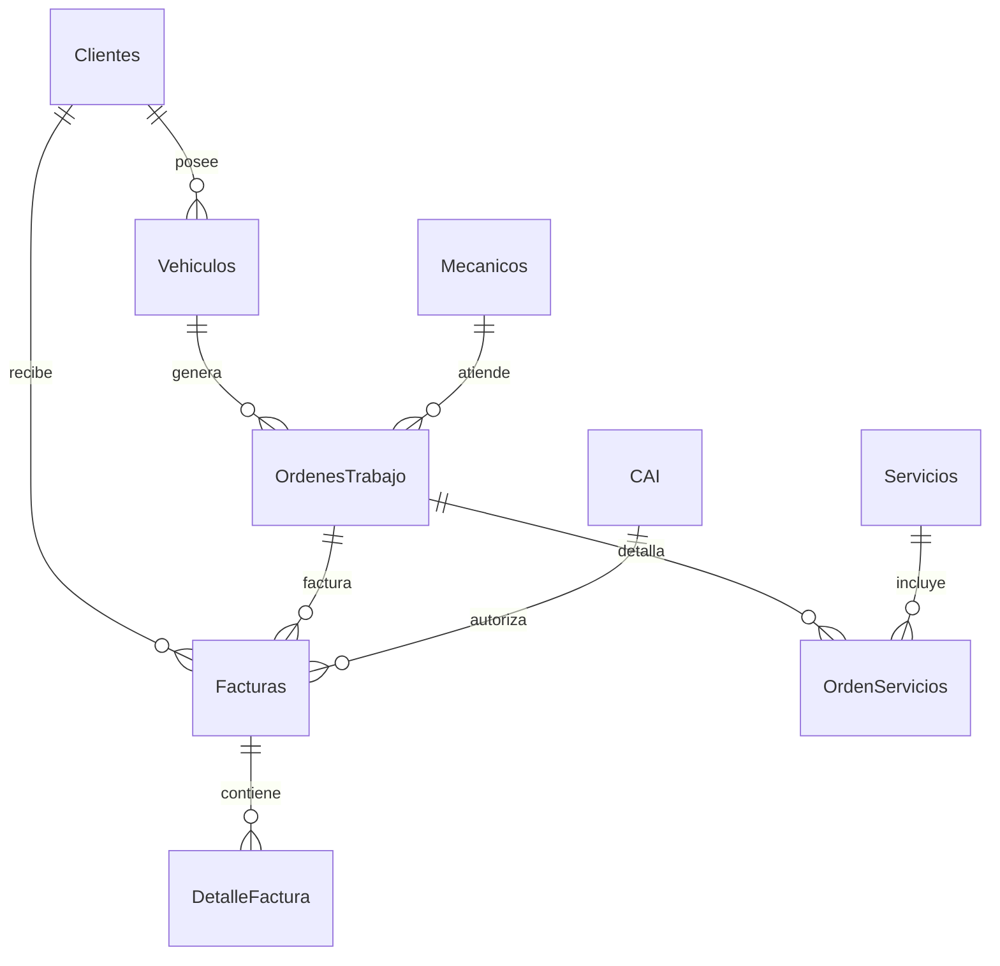

# Sprint 1 — Requisitos y diseño de órdenes, servicios y facturación

| Dato | Valor |
| --- | --- |
| Proyecto | AutoTaller Lite |
| Integrante | Yelson Israel Dominguez |
| Sprint | Sprint 1 — Análisis y estructura inicial |
| Rama | `DevYel` |
| Fecha | 26 de noviembre de 2026 |

## 1. Objetivo

Definir los requisitos funcionales, las reglas de negocio y el modelo de datos de los módulos de órdenes de trabajo, catálogo de servicios, detalle de servicios por orden, autorizaciones CAI y facturación. Este documento sirve como evidencia del análisis y diseño del Sprint 1 y como base para la implementación de los Sprints 2 y 3.

## 2. Alcance

El módulo cubre las siguientes seis tablas:

| Tabla | Propósito |
| --- | --- |
| `OrdenesTrabajo` | Encabezado de la orden: vehículo, mecánico, fecha, servicio resumido, costo estimado y estado vigente. |
| `Servicios` | Catálogo de servicios del taller con precio de referencia. No representa inventario de repuestos. |
| `OrdenServicios` | Detalle de los servicios incluidos en cada orden, con observación y costo estimado. |
| `CAI` | Autorizaciones fiscales del taller: código, rango, fecha límite, correlativo y estado. |
| `Facturas` | Encabezado del comprobante emitido, vinculado a la orden, al cliente y al CAI. |
| `DetalleFactura` | Renglones del comprobante con la copia histórica de descripción, cantidad, precio, descuento e impuesto. |

Quedan fuera de este módulo la facturación electrónica, la conexión con el SAR, los cobros en línea, el inventario de repuestos y la gestión de múltiples sucursales.

## 3. Requisitos funcionales

### 3.1 Órdenes de trabajo y servicios

| Código | Descripción |
| --- | --- |
| RF-08 | Crear órdenes de trabajo para los vehículos registrados. |
| RF-09 | Asignar un mecánico y un vehículo a cada orden de trabajo. |
| RF-10 | Registrar la descripción del servicio y su costo estimado. |
| RF-11 | Actualizar el estado de las órdenes como Pendiente, En proceso o Finalizada. |
| RF-12 | Consultar el listado de órdenes de trabajo registradas. |
| RF-13 | Registrar, consultar y actualizar servicios del catálogo con precio de referencia. |
| RF-14 | Asociar uno o varios servicios a cada orden y registrar su costo estimado. |
| RF-15 | Consultar el desglose de servicios y costos de una orden. |

### 3.2 Facturación y control de CAI

| Código | Descripción |
| --- | --- |
| RF-21 | Registrar y actualizar autorizaciones CAI: código, rango autorizado, fecha límite y correlativo vigente. |
| RF-22 | Generar una factura asociada a una orden de trabajo y al cliente correspondiente. |
| RF-23 | Incorporar al detalle los servicios, cantidades, precios, descuentos e impuestos aplicables. |
| RF-24 | Calcular y almacenar subtotal, impuestos y total de la factura. |
| RF-25 | Validar que el correlativo esté dentro del rango autorizado y que el CAI no haya vencido al emitir. |
| RF-26 | Consultar e imprimir facturas emitidas y visualizar sus datos de autorización CAI. |

## 4. Diccionario de datos

### 4.1 `OrdenesTrabajo`

| Campo | Tipo | Descripción |
| --- | --- | --- |
| `OrdenId` | `int`, PK | Identificador de la orden. |
| `VehiculoId` | `int`, FK | Vehículo que se atiende. |
| `MecanicoId` | `int`, FK | Mecánico asignado. |
| `Fecha` | `datetime2` | Fecha de creación de la orden. |
| `Servicio` | `nvarchar(250)` | Resumen del trabajo solicitado. |
| `Costo` | `decimal(12,2)` | Costo estimado global. |
| `Estado` | `nvarchar(20)` | Estado vigente: Pendiente, En proceso o Finalizada. |

### 4.2 `Servicios`

| Campo | Tipo | Descripción |
| --- | --- | --- |
| `ServicioId` | `int`, PK | Identificador del servicio. |
| `Nombre` | `nvarchar(100)` | Nombre del servicio. |
| `Descripcion` | `nvarchar(250)` | Descripción opcional. |
| `PrecioReferencia` | `decimal(12,2)` | Precio de referencia del catálogo. |

### 4.3 `OrdenServicios`

| Campo | Tipo | Descripción |
| --- | --- | --- |
| `OrdenServicioId` | `int`, PK | Identificador del detalle. |
| `OrdenId` | `int`, FK | Orden a la que pertenece. |
| `ServicioId` | `int`, FK | Servicio del catálogo. |
| `Detalle` | `nvarchar(250)` | Observación particular del servicio en la orden. |
| `CostoEstimado` | `decimal(12,2)` | Costo estimado para esa orden. |

### 4.4 `CAI`

| Campo | Tipo | Descripción |
| --- | --- | --- |
| `CAIId` | `int`, PK | Identificador de la autorización. |
| `CodigoCAI` | `nvarchar(100)`, UQ | Código de autorización. |
| `TipoDocumento` | `nvarchar(30)` | Tipo de documento autorizado. |
| `Establecimiento` | `nvarchar(10)` | Código de establecimiento. |
| `PuntoEmision` | `nvarchar(10)` | Punto de emisión. |
| `RangoInicial` | `nvarchar(20)` | Inicio del rango autorizado. |
| `RangoFinal` | `nvarchar(20)` | Fin del rango autorizado. |
| `FechaLimiteEmision` | `date` | Fecha máxima de emisión. |
| `CorrelativoActual` | `nvarchar(20)` | Correlativo vigente. |
| `Estado` | `nvarchar(20)` | Activo o inactivo. |

### 4.5 `Facturas`

| Campo | Tipo | Descripción |
| --- | --- | --- |
| `FacturaId` | `int`, PK | Identificador del comprobante. |
| `OrdenId` | `int`, FK | Orden facturada. |
| `ClienteId` | `int`, FK | Cliente que recibe el comprobante. |
| `CAIId` | `int`, FK | Autorización utilizada. |
| `NumeroFactura` | `nvarchar(30)`, UQ | Número completo del comprobante. |
| `FechaEmision` | `datetime2` | Fecha y hora de emisión. |
| `RTNCliente` | `nvarchar(20)` | RTN del cliente, si aplica. |
| `NombreCliente` | `nvarchar(160)` | Nombre fiscal del cliente. |
| `DireccionCliente` | `nvarchar(250)` | Dirección fiscal del cliente. |
| `Subtotal` | `decimal(12,2)` | Suma de líneas antes de impuestos. |
| `DescuentoTotal` | `decimal(12,2)` | Descuentos aplicados. |
| `ImpuestoTotal` | `decimal(12,2)` | Impuestos calculados. |
| `Total` | `decimal(12,2)` | Total del comprobante. |
| `Estado` | `nvarchar(20)` | Estado del comprobante. |

### 4.6 `DetalleFactura`

| Campo | Tipo | Descripción |
| --- | --- | --- |
| `DetalleFacturaId` | `int`, PK | Identificador del renglón. |
| `FacturaId` | `int`, FK | Factura a la que pertenece. |
| `Descripcion` | `nvarchar(250)` | Copia histórica de la descripción. |
| `Cantidad` | `decimal(12,2)` | Cantidad facturada. |
| `PrecioUnitario` | `decimal(12,2)` | Precio aplicado al emitir. |
| `Descuento` | `decimal(12,2)` | Descuento de la línea. |
| `Impuesto` | `decimal(12,2)` | Impuesto de la línea. |
| `SubtotalLinea` | `decimal(12,2)` | Subtotal de la línea. |

## 5. Relaciones y cardinalidades

- Un **vehículo** puede tener muchas **órdenes de trabajo**; cada orden pertenece a un vehículo.
- Un **mecánico** puede atender muchas **órdenes**; cada orden tiene un mecánico.
- Una **orden** puede tener muchos **servicios** y un servicio puede aparecer en muchas órdenes mediante `OrdenServicios` (dos relaciones 1:N).
- Un **cliente** puede recibir muchas **facturas**; cada factura pertenece a un cliente.
- Una **orden** puede generar una o varias **facturas**; cada factura pertenece a una orden.
- Una **autorización CAI** puede respaldar muchas **facturas** dentro de su rango.
- Una **factura** tiene uno o varios **renglones** en `DetalleFactura`.

## 6. Reglas de negocio

| Regla | Descripción |
| --- | --- |
| RN-02 | Toda orden debe asociarse a un vehículo y a un mecánico existentes. |
| RN-03 | `OrdenesTrabajo.Estado` conserva el estado vigente; cada cambio se registra en el historial de estados. |
| RN-04 | `OrdenesTrabajo.Servicio` es un resumen; `OrdenServicios` constituye el detalle. |
| RN-05 | El costo global es estimado; los costos por servicio son informativos y deben revisarse. |
| RN-08 | No se eliminan registros principales con dependencias sin verificar la integridad referencial. |
| RN-09 | La factura se vincula a una orden y a un cliente existentes y conserva los datos fiscales usados al emitir. |
| RN-10 | Antes de emitir se verifica que el CAI esté activo, que la fecha no supere el límite y que el correlativo esté en el rango. |
| RN-11 | El número de factura es único y respeta establecimiento, punto de emisión y correlativo del CAI. |
| RN-12 | Una factura emitida no se modifica libremente; se restringe su eliminación. |
| RN-13 | Los cálculos de subtotal, descuentos, impuestos y total se validan antes de guardar. |

## 7. Flujo de emisión de una factura

1. Verificar que la orden esté **Finalizada**.
2. Seleccionar una autorización **CAI activa**.
3. Validar que la fecha de emisión no supere `FechaLimiteEmision`.
4. Validar que `CorrelativoActual` esté dentro de `RangoInicial`–`RangoFinal`.
5. Trasladar los servicios de `OrdenServicios` al detalle del comprobante.
6. Calcular cantidad, precio, descuento, impuesto y subtotal por línea.
7. Calcular `Subtotal`, `DescuentoTotal`, `ImpuestoTotal` y `Total`.
8. Guardar `Facturas` y `DetalleFactura` como copia histórica.
9. Incrementar el correlativo de la autorización.
10. Consultar e imprimir el comprobante con sus datos de CAI.

## 8. Implementación del Sprint 1

| Elemento | Detalle |
| --- | --- |
| Modelos | `OrdenTrabajo`, `Servicio`, `OrdenServicio`, `CAI`, `Factura`, `DetalleFactura`. |
| DbContext | Seis `DbSet`, precisión `decimal(12,2)`, índices únicos y reglas de borrado. |
| Migración | `20261126031711_AddOrdenesServiciosFacturacion`. |
| Base de datos | `AutoTallerLiteDB` con 10 tablas de aplicación. |
| Integridad | 9 claves foráneas y 3 índices únicos (`CodigoCAI`, `NumeroFactura`, `Placa`). |
| Compilación | `dotnet build` sin errores ni advertencias. |

### Criterios de aceptación

- [x] Los seis modelos compilan.
- [x] Los nombres, longitudes y precisiones coinciden con el diccionario de datos.
- [x] Las relaciones 1:N están configuradas en `ApplicationDbContext`.
- [x] La migración se aplicó correctamente en SQL Server.
- [x] Se verificaron tablas, claves foráneas e índices únicos.
- [x] No se modificaron los modelos de los compañeros.
